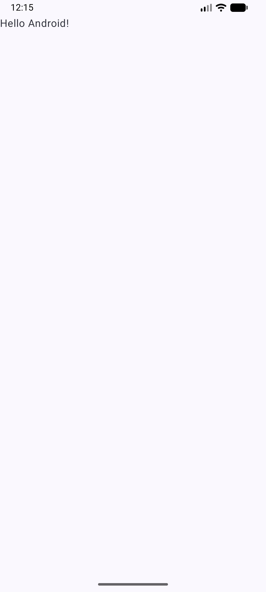

# PocketMarket

تطبيق تسوق تعليمي مبني بـ Kotlin وJetpack Compose وMaterial 3.
المنتجات من DummyJSON، والدفع والطلبات محاكاة محلية فقط وليست حقيقية.

## المتطلبات
- Android Studio (أحدث إصدار مستقر)
- JDK 17
- Android SDK (API 24 أو أعلى)

## التشغيل
1. `git clone https://github.com/ahmadlo22/pocketmarket`
2. افتح المجلد في Android Studio
3. انتظر Gradle sync
4. اضغط Run

## لقطات الشاشة
